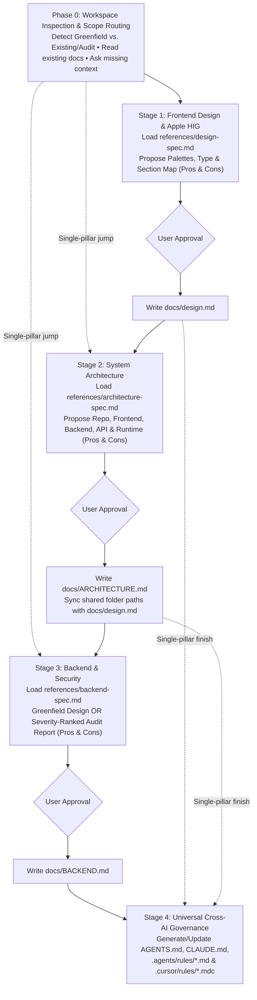

# Project Blueprint — Universal Multi-Pillar Agent Skill

> **Turn any AI coding assistant into a Principal Product Designer, Principal Software Architect, and Principal Backend & Security Engineer—working from one reconciled, zero-conflict specification system.**

`project-blueprint` is a reusable, interactive **Agent Skill** designed for **both new (Greenfield) projects and existing codebases (Audit & Upgrade)**. Instead of letting AI agents improvise inconsistent UI styles, fragile folder structures, or insecure APIs, this skill guides you through a structured, approval-gated workflow that produces production-grade specs and installs universal cross-AI governance rules so **every future session stays aligned**.

Compatible with **Google Antigravity**, **Claude Code**, **OpenAI Codex**, **Cursor**, **GitHub Copilot**, **Windsurf**, and any agent supporting `SKILL.md` / `AGENTS.md`.

---

## What You Can Achieve With This Skill

Running `project-blueprint` on a new or existing repository gives you:

1. **A Complete, Reconciled Spec Suite in `docs/`**
   - **`docs/design.md`** — Locked brand & ideal-client positioning, WCAG 2.2 AA+ 60/30/10 semantic color tokens (with dark mode & reduced-transparency fallbacks), mobile-first typography scale, per-section visual hierarchy audits, Apple HIG interaction/accessibility gates, and motion/cleanup rules.
   - **`docs/ARCHITECTURE.md`** — Executive architecture verdict + ADRs, C4 Container runtime topology diagram, a tailored 50+ line production directory tree, frontend state & backend schema ownership rules, copy-pasteable stack-native CI import-boundary configs, Docker/persistence strategy, a 10-task *"Where Does New Code Go?"* cheat sheet, and scale evolution triggers.
   - **`docs/BACKEND.md`** — Greenfield blueprint or **Severity-Ranked Security & Concurrency Audit Report** (`Critical / High / Medium / Low`), auth/session/token specification, Permission-Based RBAC + ABAC/ReBAC/RLS ownership policies, 4-layer double-entry & race-condition concurrency playbook, caching/rate-limiting/queue design, all 10 OWASP security pillars, resilient shutdown/backup operations, and mandatory pre-merge verification tests.
2. **Automatic Cross-AI Governance (Zero Rule Drift)**
   - **`AGENTS.md`** — One unified, deduplicated source of truth read natively by Antigravity, Codex, Cursor, Copilot, and Windsurf.
   - **`CLAUDE.md`** — Thin `@AGENTS.md` pointer for Claude Code so rules never duplicate or diverge.
   - **`.agents/rules/read-*.md`** — Modular Antigravity native `trigger: always_on` rules (one per active pillar).
   - **`.cursor/rules/read-*.mdc`** — Modular Cursor native `alwaysApply: true` rules (one per active pillar).
3. **Zero-Guesswork, Approval-Gated Engineering**
   - Always **inspects your workspace first** (detecting Greenfield vs. Existing/Audit mode and reading any existing docs).
   - Asks grouped clarifying questions for missing context—never guesses your brand, ideal client, stack, local Docker vs. cloud runtime, or compliance requirements.
   - Presents **2–3 concrete options with explicit Pros & Cons** at every stage and **waits for your explicit choice** before writing specs or touching code.
4. **Full 3-Pillar Setup OR Single-Pillar Runs**
   - Run the complete 3-pillar blueprint on a brand-new product, **or** invoke a single pillar (e.g., *"audit my backend"*, *"create `docs/design.md`"*, *"design `docs/ARCHITECTURE.md`"*). Single-pillar runs still cross-read existing companion docs so nothing ever contradicts.

---

## Interactive Workflow Architecture



---

## Knowledge Base & Engineering Standards Built Into This Skill

Because `project-blueprint` is an **Agent Skill** (not a fine-tuned model checkpoint), it works with *any* frontier LLM by grounding the agent in **three exhaustive, verbatim, domain-expert reference specifications** inside `references/`, loaded on demand through **progressive disclosure** so zero rules are summarized away and zero context tokens are wasted when a pillar isn't active.

Here is the exact body of standards, frameworks, and engineering practices encoded across the three pillars:

### 1. Frontend Design, Conversion & Apple HIG (`references/design-spec.md`)

- **Apple Human Interface Guidelines (HIG):**
  - Core principles: clarity, deference to content, purposeful depth, aesthetic integrity, direct manipulation, immediate feedback, restrained branding, and scalable silhouette app icons (16px–1024px, light/dark/tinted variants).
  - Visual systems: semantic color tokens, dark-mode surface elevation & hairline borders, translucent materials & vibrancy with `prefers-reduced-transparency` and `prefers-contrast: more` fallbacks, Display P3 with sRGB fallbacks.
  - Typography & UX writing: disciplined 2–3 typeface ceiling, mobile (iPhone SE 320px) vs. desktop scale, Dynamic Type / 200% text reflow, 45–75ch reading measure, `tabular-nums`, outcome-based button labels, plain-language error recovery, and inclusive copy.
  - Platform craft: SF Symbols optical alignment, CLS-free high-DPI AVIF/WebP media views, accessible video/audio playback, colorblind-safe data visualization, safe areas (`env(safe-area-inset-*)`), multitasking/full-screen, RTL CSS logical properties (`margin-inline-start`), `@media print`, and multi-modal input parity (touch, pointer, keyboard shortcuts, gaze/assistive tracking, drag-and-drop).
  - **12 Core Product Patterns:** Onboarding, forms/data entry, modality, undo/redo, search, account management (passkeys/SSO/Sign in with Apple), contextual notifications, settings, contextual help, collaboration/sharing, file auto-save/export, and ethical ratings prompts.
  - **10 Specialized Platform Modules (applied only when in scope):** Immersive 3D/XR, games/gamification, live-viewing, workouts/active sessions, Apple Pay/express checkout, Wallet passes, App Clips, NFC/Nearby Interactions, ID Verifier, and ResearchKit/surveys.
- **Conversion & Visual Hierarchy Science:**
  - Grounded in **Nielsen Norman Group's F-shaped reading research**—actively breaking passive F-scans with deliberate visual hierarchy.
  - Enforces the **3 Page Jobs** in strict priority order: *(1) Explain the product → (2) Build trust → (3) Help the person take action*.
  - Enforces solid, high-contrast primary CTAs (banning low-conversion ghost buttons) and requires answering **3 Eye-Tracking Questions** for every section (*Where does the eye land first? What gets noticed second? What gets missed completely?*).
- **WCAG 2.2 AA+ Accessibility:**
  - Minimum 4.5:1 body text contrast, 3:1 large text and UI component contrast, never color-alone status signaling, 44×44px minimum touch targets, semantic landmarks, `:focus-visible`, and full `prefers-reduced-motion` parity.
- **Cinematic Motion & Benchmark Tooling:**
  - Curated motion stack (**GSAP + ScrollTrigger**, **Lenis**, **Three.js**, **Anime.js**) with real asset-loading intros and mandatory teardown/disposal discipline.
  - Structured UI benchmarking workflow integrating **Mobbin** (via Mobbin MCP), **Land-book**, **Siteinspire**, **Footer.design**, **SaaS Landing Page**, **Apple HIG**, and a categorized **Figma reference board**.

### 2. System Architecture & Governance (`references/architecture-spec.md`)

- **Frontend Architecture Patterns Evaluated:**
  - Modular / Feature-Based SPA, Feature-Sliced Design (FSD), Route-Colocated + Feature Hybrid (Next.js App Router / Remix / Nuxt / SvelteKit), Local-First / Sync Engines (ElectricSQL, Zero, PowerSync, RxDB, Replicache), Islands / Partial Hydration, Atomic Design (`shared/ui/`), Desktop/Mobile Shell Wrappers (Tauri / Electron / Capacitor / Expo), and Micro-Frontends trade-offs.
- **Backend Architecture Patterns Evaluated:**
  - Modular Monolith with Vertical Slices (production default), Hexagonal Architecture (Ports & Adapters), Tactical DDD + Clean/Onion, Event-Driven / CQRS + Transactional Outbox, Local/Embedded Containerized Backends (PostgreSQL volumes / SQLite WAL mode), plus situational thresholds for Layered, Serverless/Edge, and Microservices.
- **Repository, Contracts & Toolchain Discipline:**
  - Monorepo (**pnpm / Turborepo / Nx / Bazel**) vs. Polyrepo, single-source-of-truth API contracts (**OpenAPI**, **tRPC**, **GraphQL**, **Protobuf/gRPC**), C4 Container modeling, and modern bundler/RSC awareness (avoiding blind `index.ts` barrel files that break tree-shaking or `"use client"` / `"use server"` boundaries).
- **Executable CI Boundary Enforcement & Operations:**
  - Copy-pasteable import-boundary configs per language: TypeScript/JS (`eslint-plugin-boundaries`, `@nx/enforce-module-boundaries`, `dependency-cruiser`), Go (`internal/` + `golangci-lint` `depguard`), Python (`import-linter`), Java/C# (`ArchUnit` / `NetArchTest`).
  - Multi-stage Dockerfiles, Compose dev/prod parity, named DB volumes, `service_healthy` startup checks, expand-and-contract migrations, RFC 9457 error envelopes, OpenTelemetry hooks, fail-fast `env` validation, and Testing Trophy/Pyramid topology.

### 3. Backend Engineering, Concurrency & Security (`references/backend-spec.md`)

- **OWASP Top 10 & OWASP API Security Top 10 (All 10 Pillars Enforced):**
  1. Strict boundary input validation & mass-assignment protection (Zod / Pydantic / Valibot / Go structs)
  2. 100% parameterized queries (zero SQL/shell/template injection)
  3. Broken Object & Function Level Authorization (BOLA/IDOR & BFLA) defense—default deny
  4. Cryptography & password hygiene (**Argon2id**, constant-time comparisons, TLS, encryption at rest)
  5. Web/API hardening (strict CORS allowlists, CSRF protection, CSP/HSTS/`nosniff`/Referrer-Policy)
  6. File upload magic-byte/MIME validation & SSRF private-IP blocking
  7. Fail-fast secrets & environment hygiene (zero secrets in code, Docker layers, or Git)
  8. Safe **RFC 9457 Problem Details** error handling (zero stack traces, SQL leaks, or user enumeration)
  9. Security audit trails & strict PII/secret log redaction
  10. Non-root minimal Docker containers, pinned lockfiles, vulnerability scanning, and least-privilege DB roles
- **Authentication & Defense-in-Depth Authorization:**
  - Stateful cookie sessions (`HttpOnly`, `Secure`, `SameSite=Lax/Strict` in Redis/DB), Hybrid Short-Lived JWT + single-use rotating Refresh Tokens with reuse detection, OAuth2/OIDC/Passkeys (WebAuthn), and explicit ban on storing auth tokens in `localStorage`/`sessionStorage`.
  - **Permission-Based RBAC** (roles as configurable DB permission buckets, never hardcoded `user.role === "admin"`) paired with **ABAC / ReBAC / Row-Level Ownership** (including PostgreSQL RLS).
- **Database Integrity & Concurrency Primitives:**
  - **4-Layer Defense Against Double Entries:** (1) UI Guard → (2) `Idempotency-Key` with payload hash & TTL → (3) DB `UNIQUE` / composite / partial unique indexes → (4) Atomic Upserts (`INSERT ... ON CONFLICT DO UPDATE`).
  - **Race-Condition Elimination:** Atomic conditional SQL updates, Pessimistic Locking (`SELECT ... FOR UPDATE` / `FOR UPDATE SKIP LOCKED` with `lock_timeout` and deadlock-safe ordering), Optimistic Concurrency Control (`version` / ETag), explicit Transaction Isolation levels, and Transactional Outbox.
- **Caching, Rate Limiting, Queues & Resilience:**
  - Cache-Aside with TTL + jitter & explicit invalidation, per-IP/user/route Sliding-Window/Token-Bucket rate limiting, background job queues with exponential backoff + idempotent handlers + Dead-Letter Queues (DLQ), and a **Proportionality Check** (evaluating whether PostgreSQL `SKIP LOCKED` + bounded LRU avoids running an extra Redis container on lightweight/local Docker setups).
  - Bounded connection pools, query/HTTP timeouts, ordered `SIGTERM` graceful shutdown, `/healthz` + `/readyz` endpoints, and concrete pre-merge security & concurrency stress-test checklists.

### 4. Shared Runtime Hygiene Gate (Cross-Pillar)

Every frontend and backend task must pass three shared operational checks consolidated into `AGENTS.md`:
- **Memory Leaks:** Remove listeners/timers/observers; kill GSAP tweens/ScrollTriggers, destroy Lenis, cancel Anime.js, dispose Three.js geometries/materials/textures/renderers; close subscriptions/sockets on unmount.
- **Race Conditions:** Ignore stale async responses; never update unmounted views; enforce a single completion path for loaders and asset gates.
- **Connection Pools:** Bounded pool sizes, mandatory timeouts, guaranteed release on both success and failure, and graceful `SIGTERM` drain order.

---

## Repository Structure

```text
project-blueprint/
├── SKILL.md                          # Lean interactive workflow, reconciliation table & governance templates
├── README.md                         # Documentation & usage guide
└── references/                       # Full, verbatim reference specifications (loaded on demand)
    ├── design-spec.md                # Pillar 1: Frontend Design, Conversion & Apple HIG
    ├── architecture-spec.md          # Pillar 2: System Architecture & Governance
    └── backend-spec.md               # Pillar 3: Backend Engineering, Concurrency & OWASP Security
```

**Why this structure?**
Using **progressive disclosure**, `SKILL.md` stays compact so it doesn't bloat your agent's context window when listed. When you run a specific pillar, the agent reads the corresponding `references/*.md` file in full—preserving 100% of the rules with zero dilution.

---

## Installation

Clone this repository directly into your AI coding agent's global (or workspace) skills directory.

### Google Antigravity (Global — Recommended)

**Windows (PowerShell):**
```powershell
git clone https://github.com/calci07/project-blueprint.git "$HOME\.gemini\config\skills\project-blueprint"
```

**macOS / Linux:**
```bash
git clone https://github.com/calci07/project-blueprint.git ~/.gemini/config/skills/project-blueprint
```

*(For workspace-only installation in Antigravity, clone into `.agents/skills/project-blueprint` inside your project root.)*

### Claude Code

```bash
# Global
git clone https://github.com/calci07/project-blueprint.git ~/.claude/skills/project-blueprint

# Or per-project
git clone https://github.com/calci07/project-blueprint.git .claude/skills/project-blueprint
```

### OpenAI Codex / Cursor / Multi-Agent Repos

```bash
# Shared workspace skill directory (discovered by Antigravity, Codex, Cursor, etc.)
git clone https://github.com/calci07/project-blueprint.git .agents/skills/project-blueprint
```

### Updating to the Latest Version

```bash
cd ~/.gemini/config/skills/project-blueprint && git pull
```

---

## How to Use It

### 1. Full 3-Pillar Setup on a Brand-New Project (Greenfield)

Open your empty or newly initialized project folder and prompt your agent:

> *"Use the `project-blueprint` skill to plan this new project from scratch."*

What happens next:
1. The agent inspects the workspace and asks grouped clarifying questions (product goal, ideal client, brand feel, target stack, online vs. offline/local Docker, security sensitivity).
2. **Stage 1 (Design):** Proposes 2–3 palettes (60/30/10 + WCAG contrast), 2–3 font pairings, and a section map with **Pros & Cons** → waits for your approval → writes `docs/design.md`.
3. **Stage 2 (Architecture):** Reads `docs/design.md`, evaluates Repo/Frontend/Backend/API/Runtime options with **Pros & Cons** → waits for your approval → writes `docs/ARCHITECTURE.md` and syncs folder paths in `docs/design.md`.
4. **Stage 3 (Backend & Security):** Reads both docs, proposes Auth, RBAC/ABAC, DB/Concurrency, and Caching/Queue options with **Pros & Cons** → waits for your approval → writes `docs/BACKEND.md`.
5. **Stage 4 (Governance):** Generates `AGENTS.md`, `CLAUDE.md`, `.agents/rules/read-*.md`, and `.cursor/rules/read-*.mdc` so every future AI session automatically obeys your blueprint.

### 2. Audit & Upgrade an Existing Codebase

Open an existing repository and ask:

> *"Use `project-blueprint` to audit my existing backend and generate `docs/BACKEND.md`."*

What happens next:
1. The agent detects existing routes, auth middleware, DB schemas/queries, Dockerfiles, and env handling.
2. It reads any existing `docs/ARCHITECTURE.md` or `docs/design.md` first.
3. It outputs a **Severity-Ranked Audit Report (`Critical / High / Medium / Low`)** pointing to exact file paths and business impact, followed by upgrade options with **Pros & Cons**.
4. Only after you approve does it write `docs/BACKEND.md`, update your governance rules, and proceed with any requested refactors.

### 3. Single-Pillar Runs (Modular Usage)

You don't have to run all three pillars at once. Any single pillar automatically cross-reads the other existing docs and updates only its own section of `AGENTS.md` and rule files:

- **Design only:** *"Run `project-blueprint` for frontend design and set up `docs/design.md`."*
- **Architecture only:** *"Run `project-blueprint` to design `docs/ARCHITECTURE.md` for this repo."*
- **Backend only:** *"Run `project-blueprint` to design our auth, permissions, and concurrency spec in `docs/BACKEND.md`."*
- **Governance sync:** *"Use `project-blueprint` to sync `AGENTS.md`, `CLAUDE.md`, `.agents/rules/`, and `.cursor/rules/` with our docs."*

### 4. Day-2 Ongoing Development

Once your blueprint is generated, you don't need to re-invoke the skill for everyday coding:
- Your always-on rules (`.agents/rules/`, `.cursor/rules/`, `AGENTS.md`, `CLAUDE.md`) automatically instruct every AI session to read `docs/design.md`, `docs/ARCHITECTURE.md`, and `docs/BACKEND.md` before planning or editing.
- Whenever a design, architectural, or security decision changes, the agent is instructed to update the corresponding `docs/*.md` file in the same change so documentation never goes stale.

---

## Zero-Conflict Reconciliation Rules

Because the three underlying briefs were originally authored independently, `SKILL.md` enforces a canonical reconciliation table so they work seamlessly as one system:

| Area | Unified Standard |
| :--- | :--- |
| **Spec Locations** | All specs live cleanly under `docs/`: `docs/design.md`, `docs/ARCHITECTURE.md`, `docs/BACKEND.md` (+ optional `docs/adr/`). |
| **Shared Paths** | `src/sections/` (marketing/editorial) + `src/features/` (app workflows) + `src/shared/tokens/` + `src/shared/ui/` are automatically synchronized between `docs/design.md` and `docs/ARCHITECTURE.md`. |
| **File Delivery** | Specs are written directly to `docs/` after approval rather than flooding chat with giant copy-paste code blocks. |
| **Multi-Agent Rules** | Unified `AGENTS.md` + thin `CLAUDE.md` + modular `.agents/rules/*.md` (Antigravity) + modular `.cursor/rules/*.mdc` (Cursor), generated only for active pillars. |
| **Runtime Quality Gates** | Memory Leaks, Race Conditions, and Connection Pools are deduplicated into one shared verification section in `AGENTS.md`. |

---

## Customizing for Your Team

Want to adapt this blueprint to your organization's house style?
- Fork this repository and edit `references/design-spec.md`, `references/architecture-spec.md`, or `references/backend-spec.md`.
- Or adjust default stage ordering and output conventions in `SKILL.md`.
- Commit the customized skill to `.agents/skills/project-blueprint/` in your team's monorepo (or register it via `.agents/skills.json`) so every developer's agent uses the exact same standards.
